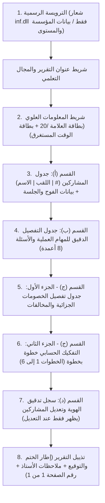

# مواصفات التقرير النهائي للمحاكاة — الإصدار المعياري v2.2
**تاريخ التوثيق والختم:** 27 نوفمبر 2026 — 11:15:00  
**رقم الإصدار المعياري:** `v2.2-canonical`  
**الملف المصدري المسؤول:** [`js/pedagogy/report.js`](file:///d:/enseignement/dev_tools/settings_projects/003/js/pedagogy/report.js)  
**ملف المعاينة البصرية الحية:** [`REPORT_SPEC_v2.2_2026-11-27_11-15-00.preview.html`](file:///d:/enseignement/dev_tools/settings_projects/003/docs/report_versions/REPORT_SPEC_v2.2_2026-11-27_11-15-00.preview.html)

---

## 1. أهداف الإصدار والتعديلات الجذرية في v2.2

استجابةً للملاحظات الدقيقة والاشتراطات الصارمة للإخراج والطباعة:
1. **الترويسة (Official Header):**
   - إزالة أي شعار افتراضي لوزارة التربية أو أي رمز عشوائي fallback.
   - الشعار الوحيد المعتمد هو الشعار المختار من قِبل الأستاذ في ملف `inf.dll` (`cfg.report_logo_b64`). في حال عدم إدراجه يُترك مكانه فارغاً وتُستغل المساحة للبيانات الرسمية يميناً ويساراً (تخطيط متوازن بعمودين `no-logo`).
   - نص الجمهورية والوزارة في الأعلى مرتفع ومحمي بمسافة أمان كافية عن الحافة العلوية.
2. **شريط المعلومات العلوي (Top Information Bar):**
   - تموضع بطاقتي العلامة والوقت في أعلى التقرير مباشرةً بعد شريط العنوان الرسمي (المجال التعلمي)، لتظهر النتيجة والوقت بوضوح تام للقارئ قبل الخوض في التفاصيل.
   - بطاقة العلامة المستحقة تبرز العلامة بخط عريض `XX.XX / 20.00` مع توضيح صريح `(XX.XX من أصل 20.00)` وشارة معيار النجاح.
   - بطاقة الوقت المستغرق تبرز الوقت بنسق رقمي واضح ومحكم `00:00:00` وشارة اكتمال المهام.
3. **قسم المشاركين وبيانات الجلسة (القسم أ):**
   - تنظيم المشاركين في جدول منسق بعمودين رئيسيين واضحين: عمود للألقاب وعمود للأسماء (`# | اللقب | الاسم`)، مع محاذاة منضبطة وأبعاد ثابتة.
   - استيعاب تلميذ واحد أو عدة تلاميذ (حتى 4 تلاميذ في العمل المشترك) دون أي تداخل في النصوص.
   - حماية تاريخ وتوقيت الإنجاز داخل الإطار: رفع الحد الأدنى لارتفاع إطار القسم (أ) إلى `138px` على Canvas ومحاذاة التاريخ عند `Y + 90`، مما يضمن مسافة أمان رأسية واسعة (> 48px) تمنع نهائياً ملامسة التاريخ للخط السفلي للإطار أو الخروج عنه.
4. **قسم طريقة التنقيط (القسم ب):**
   - جدول تفصيلي دقيق بـ 8 أعمدة توضح المعايير، المهام العملية، الأسئلة، المحاولات، المعامل الأقصى، النقاط الممنوحة، الخصومات والملاحظات.
   - ضبط التفاف النصوص والقص الآمن للأعمدة لمنع تداخل الحروف أو تشويه الحدود.
5. **قسم طريقة الخصم والتفكيك الحسابي (القسم ج):**
   - جدول مخصص ومستقل للخصومات الجزائية يرصد أسباب الخصم، التوقيت، السياق، والإجراءات المخالفة بدقة (أو بطاقة تأكيد خضراء تثبت سلامة الأداء بدون أي خصومات).
   - التفكيك الحسابي للعلامة خطوة بخطوة (الخطوات 1 إلى 6) وتطبيق القاعدة الثلاثية الرسمية وصولاً إلى العلامة النهائية المعتمدة.
6. **بساطة اللغة ومنع كلمة «بيداغوجي» نهائياً:**
   - الحظر التام لكلمة «بيداغوجي» ومشتقاتها واستبدالها بلغة عربية تربوية سليمة وواضحة يفهمها التلميذ والأستاذ على حد سواء.
7. **تذييل الصفحة:**
   - ختم وتوقيع الأستاذ(ة)، ملاحظات وتوجيهات الأستاذ(ة)، ورقم الصفحة `صفحة 1 من 1`.

---

## 2. الهيكل التراتبي الدقيق للتقرير (A4 Canvas & HTML)

---

## 3. معايير القياس والتخطيط على Canvas (A4 1240 × 1754 px)

| العنصر | الإحداثيات الرأسية (Y) | الارتفاع والحدود | الملاحظات التقنية |
|---|---|---|---|
| سطر الجمهورية والوزارة | Y = 78 و Y = 99 | خط عريض، مركز | مسافة أمان > 38px عن الحافة العلوية |
| الشعار والمؤسسة والمستوى | Y = 115 .. 160 | يمين/يسار | يُرسم الشعار فقط عند توفره كصورة من `inf.dll` |
| شريط العنوان والمجال | Y = 170 .. 220 | H = 50px | خلفية رمادية هادئة `#F8FAFC` بإطار `#CBD5E1` |
| شريط المعلومات العلوي (العلامة والوقت) | Y = 228 .. 294 | H = 66px | بطاقتان متجاورتان بإطار 2px وتظليل مميز |
| القسم (أ): المشاركون والجلسة | Y = 306 .. 444+ | H = Math.max(138, ...) | جدول المشاركين يميناً، وبيانات الجلسة يساراً (التاريخ عند Y+90، رقم التقرير عند Y+112) |
| القسم (ب): جدول المهام والأسئلة | Y = 460 .. ديناميكي | H = صفوف بـ 32px | قص صارم للنصوص في خانة الملاحظات |
| القسم (ج): جدول الخصومات | ديناميكي | H = صفوف بـ 28px | جدول أحمر فاتح للخصومات أو إطار أخضر عند انعدامها |
| خطوات الحساب 1 إلى 6 | ديناميكي | H = 32px لكل خطوة | الخطوة 4 القاعدة الثلاثية، الخطوة 5 الخصم، الخطوة 6 العلامة النهائية |
| سجل التدقيق (القسم د) | ديناميكي | يُرسم فقط عند وجود تعديل | جدول تدقيق توقيت التعديل ونسبة الإنجاز عند الحذف/الإضافة |
| التوقيع وتذييل الصفحة | Y = 1540 .. 1690 | H = 150px | إطار الختم المنقط، أسطر الملاحظات، ورقم الصفحة `صفحة 1 من 1` |

---

## 4. سياسة الرجوع والاعتماد

في حال الرغبة في مراجعة أو العودة إلى إصدار سابق أو معاينة الإصدار الحالي، تتوفر النسخ في المجلد:
- الإصدار v2.0: [`REPORT_SPEC_v2.0_2026-11-27_09-15-29.md`](file:///d:/enseignement/dev_tools/settings_projects/003/docs/report_versions/REPORT_SPEC_v2.0_2026-11-27_09-15-29.md)
- الإصدار v2.1: [`REPORT_SPEC_v2.1_2026-11-27_09-45-00.md`](file:///d:/enseignement/dev_tools/settings_projects/003/docs/report_versions/REPORT_SPEC_v2.1_2026-11-27_09-45-00.md)
- **الإصدار المعتمد الحالي v2.2:** [`REPORT_SPEC_v2.2_2026-11-27_11-15-00.md`](file:///d:/enseignement/dev_tools/settings_projects/003/docs/report_versions/REPORT_SPEC_v2.2_2026-11-27_11-15-00.md)
