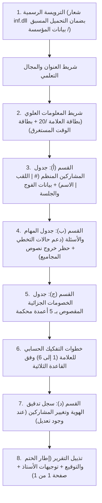

# مواصفات التقرير النهائي للمحاكاة — الإصدار المعياري v2.3 (الإصدار المعتمد والنهائي)
**تاريخ التوثيق والختم:** 27 نوفمبر 2026 — 12:15:00  
**رقم الإصدار المعياري:** `v2.3-canonical` (Active Canonical Master)  
**الملف المصدري المسؤول:** [`js/pedagogy/report.js`](file:///d:/enseignement/dev_tools/settings_projects/003/js/pedagogy/report.js)  
**ملف المعاينة البصرية الحية:** [`REPORT_SPEC_v2.3_2026-11-27_12-15-00.preview.html`](file:///d:/enseignement/dev_tools/settings_projects/003/docs/report_versions/REPORT_SPEC_v2.3_2026-11-27_12-15-00.preview.html)

---

## 1. أهداف الإصدار والتعديلات الجذرية في v2.3

استجابةً للاختبارات الصارمة والملاحظات المرفقة في الصور:
1. **ظهور شعار الأستاذ بضمان 100% (Teacher Logo Preload & Async Ready):**
   - تم حل مشكلة عدم ظهور الشعار عند التصدير عبر آلية `ensureLogoReady` و `preloadLogo` المدمجة التي تضمن فك تشفير صورة الشعار (`cfg.report_logo_b64`) بالكامل في الذاكرة وتوفر `naturalWidth > 0` قبل بدء الرسم على الـ Canvas.
   - الشعار المعتمد حصراً هو شعار الأستاذ المخزن في `inf.dll`. في حال عدم وجوده تظل المساحة نظيفة تماماً دون أي شعار افتراضي.
   - أبعاد الشعار: `maxW = 86px`, `maxH = 54px`، متموضع بتوسط هندسي مثالي عند `X = 620 - (drawW / 2)` و `Y = 108 + (54 - drawH) / 2`.

2. **منع خروج النص وتداخله منعاً باتاً (Zero Text Bleed & Strict Boundary Clipping):**
   - **في سطر المجاميع (القسم ب):** استبدال الجملة الطويلة التي كانت تخرج عن إطارها عند كلمة "مطلوبة" وتخترق الإطار الأزرق الأيسر بصيغة موجزة ومضبوطة: `استيفاء X.XX من Y.YY ن`، مع تطبيق قص صارم `ctx.rect(80, curY, 175, 34); ctx.clip();`.
   - **في تفصيلات الخصومات (القسم ج):** إلغاء السطر النصي الطويل الممتد عبر الصفحة واستبداله بجدول مهيكل منظم من 5 أعمدة:
     `# (عرض 40px) | نوع المخالفة وسبب الخصم (عرض 350px) | توقيت وسياق المخالفة (عرض 250px) | الإجراء أو الإعداد المرصود (عرض 320px) | قيمة الخصم (عرض 120px)`.
     كل خلية من خلايا هذا الجدول مقصوصة بحدود صارمة `ctx.clip()` تمنع أي تجاوز بصري بصورة قطعية.

3. **تكبير حجم الخط في التقرير عامة (Scaled-up Crisp Typography):**
   - ترقية وتكبير كافة أحجام الخطوط على الـ Canvas والـ HTML لضمان قراءة مريحة وواضحة جداً على الشاشات ومختلف أنواع الطابعات:
     - ترويسة الجمهورية: 18px عريض، الوزارة: 15px عريض.
     - بيانات المؤسسة والأستاذ: 13px / 14px عريض.
     - عنوان التقرير الرئيسي: 22px عريض جداً، المجال التعلمي: 13.5px.
     - شريط المعلومات العلوي: العلامة `900 29px`، الوقت `900 27px Consolas`، العناوين والشارات: 12.5px - 13.5px.
     - جداول المهام والأسئلة: رؤوس الأعمدة 13px عريض، البيانات 12.5px - 14px عريض، الملاحظات 12px.
     - خطوات الحساب: 12.5px إلى 14.5px، والعلامة النهائية `900 18px`.
     - التوقيع وتذييل الصفحة: 11.5px إلى 13.5px عريض.

4. **نظام تخطي الأسئلة الجديد (Question Skip System):**
   - **تخطي السؤال الحالي («تخطي هذا السؤال»):** زر مخصص في نافذة السؤال يتيح للتلميذ تخطي السؤال النشط بعد تأكيد اختياره، تصفير علامته (0.00 من 1.00 ن)، والانتقال فوراً للمهمة العملية الموالية.
   - **تخطي كافة الأسئلة («تخطي كل الأسئلة»):** زر تحذيري بتأكيد صريح يتيح للتلميذ إلغاء ظهور كافة الأسئلة التقويمية المتبقية لمواصلة الجانب التطبيقي فقط دون مقاطعة، مع إدراج معاملات الأسئلة في المقام وتصفير علاماتها وفق القاعدة الثلاثية.
   - **التوثيق الدقيق في التقرير:**
     - ظهور شارة كهرمانية واضحة `تم التخطي` أو `تم التخطي (الكل)`.
     - تفصيل الخصم في خانة الملاحظات: `-1.00 ن (تم تخطي السؤال بطلب التلميذ)`.
     - توضيح شامل في الخطوة 2 من القسم (ج) يبين تصفير الأسئلة بطلب التلميذ مع بقاء معاملاتها ضمن المجموع الكلي.

5. **الحظر المطلق للفظ «بيداغوجي»:**
   - خلو كامل للملفات، الواجهات، والتقارير من كلمة «بيداغوجي» ومشتقاتها، واستبدالها بمصطلحات عربية وتربوية رصينة (مثل: «توجيه إرشادي»، «تنبيه توضيحي»).

---

## 2. الهيكل التراتبي للتقرير المعياري v2.3

---

## 3. إحداثيات ومحددات أبعاد Canvas (1240 × 1754 px)

| القسم / العنصر | إحداثيات Y | العرض والارتفاع | سياسة الأمان والحدود |
|---|---|---|---|
| ترويسة الجمهورية والوزارة | Y = 78 و Y = 99 | خط عريض، مركز | مسافة أمان رأسية واسعة عن الحافة العلوية |
| شعار الأستاذ (`inf.dll`) | Y = 108 .. 162 | max 86 × 54 px | توسيط هندسي X=620، مرسوم بعد التحقق من جاهزية الصورة |
| بيانات المؤسسة والسنة | Y = 115 .. 160 | يمين / يسار | خطوط مكبرة 13px - 14px |
| شريط العنوان والمجال | Y = 170 .. 220 | H = 50px | عنوان عريض 22px ومجال 13.5px |
| شريط المعلومات العلوي | Y = 228 .. 296 | H = 68px | العلامة 29px والوقت 27px Consolas |
| القسم (أ): بيانات التلميذ | Y = 308 .. 450+ | H = Math.max(142, ...) | جدول المشاركين يميناً، وبيانات الجلسة يساراً (التاريخ عند Y+96) |
| القسم (ب): جدول المهام والأسئلة | Y = 466 .. ديناميكي | صفوف 32px و 28px | قص خانة الملاحظات عند 175px، دعم شارات التخطي |
| سطر مجاميع القسم (ب) | ديناميكي | H = 34px | `استيفاء X من Y ن` مقصوصة عند [80, Y, 175, 34] |
| القسم (ج): جدول الخصومات | ديناميكي | H = صفوف بـ 26px | جدول 5 أعمدة، كل عمود مقصوص بـ `ctx.clip()` |
| خطوات الحساب 1 إلى 6 | ديناميكي | H = 32px لكل خطوة | خطوط مكبرة 12.5px - 14.5px، والعلامة النهائية 18px |
| سجل التدقيق (القسم د) | ديناميكي | يُرسم عند التعديل | يوثق توقيت ونسبة إنجاز الجلسة لحظة استبعاد أو إضافة أي تلميذ |
| التوقيع وتذييل الصفحة | Y = 1540 .. 1690 | H = 150px | إطار الختم المنقط، أسطر الملاحظات، ورقم الصفحة `صفحة 1 من 1` |

---

## 4. سجل الإصدارات وسياسة الاعتماد

- الإصدار v2.0: [`REPORT_SPEC_v2.0_2026-11-27_09-15-29.md`](file:///d:/enseignement/dev_tools/settings_projects/003/docs/report_versions/REPORT_SPEC_v2.0_2026-11-27_09-15-29.md)
- الإصدار v2.1: [`REPORT_SPEC_v2.1_2026-11-27_09-45-00.md`](file:///d:/enseignement/dev_tools/settings_projects/003/docs/report_versions/REPORT_SPEC_v2.1_2026-11-27_09-45-00.md)
- الإصدار v2.2: [`REPORT_SPEC_v2.2_2026-11-27_11-15-00.md`](file:///d:/enseignement/dev_tools/settings_projects/003/docs/report_versions/REPORT_SPEC_v2.2_2026-11-27_11-15-00.md)
- **الإصدار المعياري المعتمد والنهائي v2.3:** [`REPORT_SPEC_v2.3_2026-11-27_12-15-00.md`](file:///d:/enseignement/dev_tools/settings_projects/003/docs/report_versions/REPORT_SPEC_v2.3_2026-11-27_12-15-00.md)
