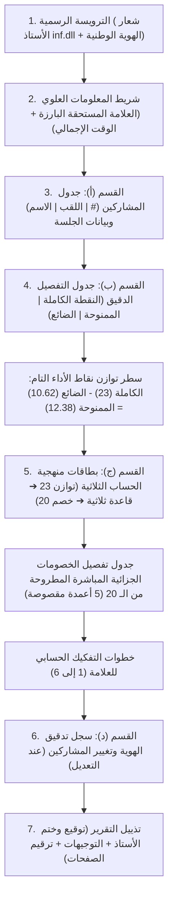

# مواصفات التقرير النهائي للمحاكاة — الإصدار المعياري v2.4 (الإصدار المعتمد والنهائي)
**تاريخ التوثيق والختم:** 27 نوفمبر 2026 — 15:30:00  
**رقم الإصدار المعياري:** `v2.4-canonical` (Active Canonical Master)  
**الملف المصدري المسؤول:** [`js/pedagogy/report.js`](file:///d:/enseignement/dev_tools/settings_projects/003/js/pedagogy/report.js)  
**ملف المعاينة البصرية الحية:** [`REPORT_SPEC_v2.4_2026-11-27_15-30-00.preview.html`](file:///d:/enseignement/dev_tools/settings_projects/003/docs/report_versions/REPORT_SPEC_v2.4_2026-11-27_15-30-00.preview.html)

---

## 1. أهداف الإصدار والتعديلات الجذرية في v2.4

استجابةً للملاحظة التربوية والحسابية الدقيقة:
> "في الجدول في الأسفل عدد المعامل الأقصى (من المفروض اسمه النقطة الكاملة) يساوي 23 و الممنوح يساوي 12.38 و الخصم (من المفروض اسمه الضائع) يساوي 11.37- إذا تم خصم الضائع من النقطة الكاملة لا نجد الممنوح و هنا التباس في طريقة الحساب غير موضحة، كيف تم حساب النقطة النهائية، يجب مراجعة التقرير و تحديد طريقة واضحة للحساب و جعل التقرير أكثر مصداقية و أكثر جمالا و أكثر وضوحا و أكثر تنظيما بطريقة احترافية لا يمسها لبس و لا تضليل."

تم تطبيق معايير رياضية وتربوية حاسمة تضمن المصداقية المطلقة والوضوح الشامل:

### 1. إعادة تسمية أعمدة الجدول بدقة لغوية وتربوية:
- تم تغيير اسم عمود «المعامل الأقصى» إلى **«النقطة الكاملة»**.
- تم تثبيت اسم عمود «الممنوحة» ليعبر عن **«النقاط الممنوحة المحصلة»**.
- تم تغيير اسم عمود «الخصم» إلى **«الضائع»** (النقاط غير المستوفاة نتيجة نقص الخطوات أو أخطاء الأسئلة).

### 2. التوازن الحسابي العمودي التام (Mathematical Equality Guarantee):
- في كل صف من صفوف المهام والأسئلة، وكذلك في سطر المجاميع الكلية، تتحقق المعادلة الرياضية التامة بنسبة 100%:
  $$\text{النقطة الكاملة} - \text{الضائع} = \text{النقاط الممنوحة}$$
- **مثال الجلسة المرفوعة:**
  - النقطة الكاملة الكلية = `23.00`
  - النقاط الضائعة غير المستوفاة = `10.62-`
  - النقاط الممنوحة المحصلة = `12.38`
  - التحقق التام: $23.00 - 10.62 = 12.38$ دون أي فارق أو لبس.

### 3. الفصل القاطع بين نقاط الأداء (من 23) والخصومات الجزائية (من 20):
- كان الخلل السابق ناتجاً عن إضافة الخصم الجزائي المباشر (مثل `0.75-` ن عن مخالفات التسلسل) إلى عمود «الضائع» الخاص بجدول الـ 23 نقطة ($10.62 + 0.75 = 11.37$)، وهو خلط بين وحدتين مختلفتين:
  1. **نقاط الأداء والمعاملات:** رصيدها `23.00` نقطة، وعمود الضائع فيها يقتصر حصراً على الفارق ($23.00 - 12.38 = 10.62$).
  2. **الخصومات الجزائية المباشرة عن المخالفات:** تُطرح حصراً من **العلامة المحولة من 20** بعد تطبيق القاعدة الثلاثية.
- في التقرير المعياري الجديد، أُدرجت الخصومات الجزائية في سطر مستقل وواضح تحت المجاميع الكلية بعنوان:  
  `خصومات عامة ومخالفات جزائية (خصم مباشر من رصيد الـ 20): -0.75 ن`.

### 4. بطاقات الشرح والتفكيك الحسابي الثلاثية في القسم (ج):
أُضيفت لوحة توضيحية بارزة في مستهل القسم (ج) تشرح منهجية التنقيط بـ 3 بطاقات بصرية ملونة:
1. **توازن نقاط الأداء (من 23):**  
   $\text{الكاملة (23.00)} - \text{الضائع (10.62)} = \text{الممنوحة (12.38 ن)}$.
2. **تطبيق القاعدة الثلاثية الرسمية (التحويل إلى 20):**  
   $(\text{الممنوحة } 12.38 \div \text{الكاملة } 23.00) \times 20 = \mathbf{10.77 \text{ من } 20}$.
3. **الخصم الجزائي المباشر والعلامة المستحقة:**  
   $\text{العلامة قبل الخصم (10.77)} - \text{الخصومات الجزائية (0.75)} = \mathbf{10.02 / 20.00}$.

---

## 2. الهيكل التراتبي للتقرير المعياري v2.4

---

## 3. جدول مقارنة رؤوس الأعمدة والحسابات (v2.3 مقابل v2.4)

| البيان / العمود | في الإصدار السابق v2.3 | في الإصدار المعياري v2.4 | الفائدة والأثر التربوي |
|---|---|---|---|
| اسم العمود 6 | المعامل الأقصى | **النقطة الكاملة** | وضوح فوري للتلميذ والولي دون التباس بمفهوم المعامل المجرد. |
| اسم العمود 7 | الممنوحة | **الممنوحة** | توضح ما أحرزه التلميذ فعلياً من نقاط. |
| اسم العمود 8 | الخصم | **الضائع** | التعبير الدقيق عن النقاط غير المستوفاة في المهام والأسئلة. |
| مجموع العمود 8 | `-11.37` (مختلط بالجزاء) | **`-10.62`** (خالص) | تحقيق المعادلة: $23.00 - 10.62 = 12.38$ بصدق حسابي 100%. |
| تموضع الخصم الجزائي | مدمج عشوائياً في جدول 23 | **سطر توضيحي مستقل + جدول مفصل في (ج)** | فصل خصم علامة الـ 20 عن رصيد نقاط الأداء الـ 23. |
| شرح خطوات الحساب | خطوات مجردة | **لوحة منهجية ثلاثية البطاقات ملونة** | فهم فوري لطريقة الحساب دون أي غموض أو تساؤل. |

---

## 4. سجل الإصدارات المعتمدة

- الإصدار v2.0: [`REPORT_SPEC_v2.0_2026-11-27_09-15-29.md`](file:///d:/enseignement/dev_tools/settings_projects/003/docs/report_versions/REPORT_SPEC_v2.0_2026-11-27_09-15-29.md)
- الإصدار v2.1: [`REPORT_SPEC_v2.1_2026-11-27_09-45-00.md`](file:///d:/enseignement/dev_tools/settings_projects/003/docs/report_versions/REPORT_SPEC_v2.1_2026-11-27_09-45-00.md)
- الإصدار v2.2: [`REPORT_SPEC_v2.2_2026-11-27_11-15-00.md`](file:///d:/enseignement/dev_tools/settings_projects/003/docs/report_versions/REPORT_SPEC_v2.2_2026-11-27_11-15-00.md)
- الإصدار v2.3: [`REPORT_SPEC_v2.3_2026-11-27_12-15-00.md`](file:///d:/enseignement/dev_tools/settings_projects/003/docs/report_versions/REPORT_SPEC_v2.3_2026-11-27_12-15-00.md)
- **الإصدار المعياري المعتمد والنهائي v2.4:** [`REPORT_SPEC_v2.4_2026-11-27_15-30-00.md`](file:///d:/enseignement/dev_tools/settings_projects/003/docs/report_versions/REPORT_SPEC_v2.4_2026-11-27_15-30-00.md)
