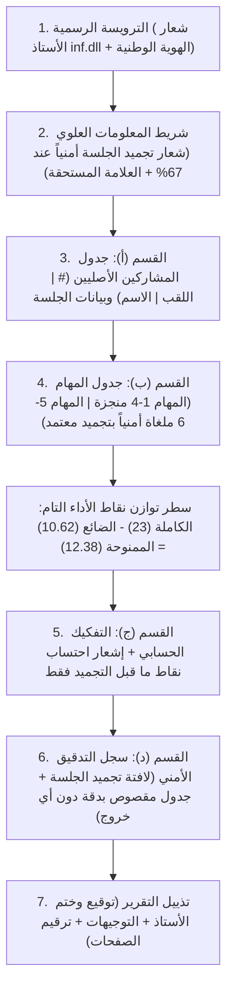

# مواصفات التقرير النهائي للمحاكاة — الإصدار المعياري v2.5 (معالجة تدقيق الهوية وتجميد الجلسة)
**تاريخ التوثيق والختم:** 27 نوفمبر 2026 — 17:00:00  
**رقم الإصدار المعياري:** `v2.5-canonical` (Active Canonical Master)  
**الملف المصدري المسؤول:** [`js/pedagogy/report.js`](file:///d:/enseignement/dev_tools/settings_projects/003/js/pedagogy/report.js)  
**ملف المعاينة البصرية الحية:** [`REPORT_SPEC_v2.5_2026-11-27_17-00-00.preview.html`](file:///d:/enseignement/dev_tools/settings_projects/003/docs/report_versions/REPORT_SPEC_v2.5_2026-11-27_17-00-00.preview.html)

---

## 1. أهداف الإصدار والتعديلات الجذرية في v2.5

استجابةً لطلب الأستاذ والملاحظات الدقيقة على إخراج القسم (د):
> «خروج النص في القسم "د" و كتابة صغيرة غير واضحة و بالنسبة للقسم "د" في هذه الحالة التي تم استخراج التقرير فيها أنهى التلميذ المحاكاة بإنجاز النسبة المذكورة لكن بقية النسبة لإتمام المائة بالمائة تم إلغاؤها فلا يستطيع التلميذ الذي انتحل مكان الفوج السابق مواصلة المحاكاة و هذا غير واضح .»

تم تنفيذ وتوثيق حزمة تطويرية شاملة على مستويات التصميم، الخطوط، القص الهندسي (Clipping)، والحوكمة الأمنية والتربوية:

---

### 1. معالجة خروج النصوص والتفاف الأسطر الكامل بدون أي اختصار أو إخفاء (Dynamic Multi-Line Text Wrapping & Zero Truncation)
- **توجيه الأستاذ الحاسم:**
  > «المعلومات المذكورة عند تغيير معلومات الجلسة مهمة لذى يجب أن تظهر كاملة و يجب على التقرير أن يكتبها بطريقة صحيحة لا تقبل التأويل و يجب الرجوع إلى السطر و كتابة النص كاملا إذا كان النص طويلا و على التقرير استيعاب ذلك و إظهار النص صحيحا و ليس مختصرا أو مخفيا.»
- **الحل الجذري المطبق والمعتمد:**
  1. **الالتفاف الذكي للكلمات والرجوع إلى السطر (`wrapCanvasText`):**
     تم تطوير خوارزمية التفاف كلمات ديناميكية تفحص عرض النص عبر `ctx.measureText` وتوزعه على أسطر متعددة بعرض أقصى `540px` (يبدأ بمحاذاة يمينية من `x = 635` وينتهي عند `x = 95`، متراجعاً بأمان قبل حد الجدول الأيسر عند `x = 80`).
  2. **منع تام للاختصار أو الإخفاء (Zero Truncation / No Ellipsis):**
     - تم إلغاء كافة عمليات الاقتطاع (`.substring`) ونقاط الحذف (`...`) من العمود الخامس والسادس.
     - تظهر كافة أسماء المشاركين كاملة (اللقب والاسم بدون اختصار) لكل من التلاميذ المستبعدين والتلاميذ المتبقين.
     - تظهر الإشعارات الأمنية وتفاصيل القرار الأمني كاملة بكل مفرداتها دون أي إخفاء خلف حواف ثابتة.
  3. **استيعاب التقرير للارتفاع ديناميكياً (Dynamic Row Height):**
     - يتم حساب إجمالي الأسطر الناتجة في العمود السادس والخامس، ويتمدد ارتفاع الصف تلقائياً:
       `modRowH = Math.max(42, maxLines * 18 + 14)`
     - تتنقل إحداثيات الصفوف اللاحقة وصندوق توقيع وختم الأستاذ(ة) ديناميكياً إلى الأسفل لضمان تناسق التقرير وعدم تداخل أي عناصر.
  4. **إعادة توزيع أعمدة الجدول بنسب احترافية:**
     - في HTML: تم توسيع العمود السادس إلى **44%** من إجمالي الجدول، مع ضبط `white-space: normal; word-break: break-word; line-height: 1.55;`.
     - في Canvas: تم حجز عرض **565px** للعمود السادس (من x = 80 إلى x = 645) مقابل أعمدة المراحل والتواقيت ونسب الإنجاز.

---

### 2. تكبير وتوضيح الخطوط (Typography Upgrade)
- تم رفع مقاس الخطوط في القسم (د) من `9.5px` (غير واضحة) إلى:
  - **عنوان القسم:** خط عريض `12.5px` بلون كهرماني داكن عالي التباين (`#92400E`).
  - **شريط القرار الأمني:** خط عريض `11.5px` بلون أحمر داكن (`#991B1B`).
  - **ترويسة أعمدة الجدول:** خط عريض `11px` مريح للقراءة.
  - **بيانات الصفوف:** خط عريض واضح `11px` إلى `11.5px`، مع زيادة ارتفاع الصفوف إلى `26px` (للتسجيل الأولي) و `46px` (لصفوف التعديل الأمني).

---

### 3. إعلان قرار تجميد الجلسة وإلغاء النسبة المتبقية بوضوح قاطع
عند رصد أي تعديل في هوية المشاركين أثناء سير المحاكاة (مثل استبعاد تلميذين عند نسبة إنجاز 67%):
1. **في شريط المعلومات العلوي (أعلى الصفحة):**
   يتحول شريط الوقت الإجمالي فوراً إلى حالة التجميد الأمني:
   `⚠️ جلسة موقوفة ومجمدة أمنياً عند نسبة (67%) — إلغاء استكمال المهام المتبقية`
2. **في القسم (ب) (جدول المهام العملية والأسئلة التقويمية):**
   - كافة المهام والأسئلة غير المنجزة التالية للتعديل (المهام 5 و6) تُوسم فوراً بحالة:  
     **`ملغاة أمنياً (تجميد)`**
   - في عمود الملاحظات يُكتب نص صريح ومفصل:  
     `ملغاة أمنياً — تم تجميد الجلسة وإلغاء استكمال النسبة المتبقية إثر تعديل الهوية عند (67%).`
3. **في القسم (ج) (التفكيك الحسابي للعلامة):**
   يُدرج تنبيه نزاهة يوضح أن العلامة تحتسب حصراً عن المهام الأربع المنجزة قبل التجميد، وأن المهام الملغاة تُحسب بـ `0.00` نقطة لحرمان التلميذ البديل من الاستفادة من رصيد الفوج الأصلي.
4. **في القسم (د) (سجل التدقيق):**
   - لافتة تحذير رسمية عريضة باللون الأحمر:  
     `قرار أمني وتربوي حاسم (مكافحة الانتحال وتجميد الجلسة): تم رصد استبعاد/تعديل هوية المشاركين أثناء سير المحاكاة عند نسبة إنجاز (67% — 4 من 6 مهام). وتطبيقاً لمبدأ حماية نزاهة التقويم وحقوق الفوج الأصلي، تم تجميد الجلسة نهائياً وإلغاء النسبة المتبقية (33%)، ومنع التلميذ البديل من مواصلة المحاكاة أو الاستيلاء على نقاط الفوج السابق.`
   - عمود المرحلة يوضح صراحة: `تعديل 1 [تجميد أمني]`.
   - عمود البيان المعدل يوضح: `حذف تلاميذ [تجميد المحاكاة]`.

---

## 2. الهيكل التراتبي الشامل للتقرير المعياري v2.5

---

## 3. جدول المقارنة الفنية واللغوية (v2.4 مقابل v2.5)

| العنصر | في الإصدار v2.4 | في الإصدار المعياري v2.5 | الأثر والنتيجة التربوية والجمالية |
|---|---|---|---|
| نص تفاصيل التغيير بالقسم (د) | سطر وحيد يتجاوز الحد الأيسر ويدخل مربع الختم | **مقصوص هندسياً داخل الخانة وموزع على سطرين** | انعدام تام لأي تداخل أو خروج عن الإطار (Zero Overflow). |
| مقاس خطوط القسم (د) | `9.5px` صغيرة وغير واضحة | **`11px` إلى `12.5px` عريضة وواضحة جداً** | سهولة وقابلية القراءة على الشاشة وفي الطباعة الورقية. |
| حالة الجلسة عند تعديل المشاركين | يظهر كجلسة عادية قيد الإنجاز | **إعلان صريح بتجميد الجلسة وتوقيف المحاكاة** | قطع دابر التلاعب ومنع التلميذ البديل من انتحال الهوية. |
| مصير النسبة المتبقية (33%) | غير محددة وتثير اللبس | **ملغاة أمنياً ومثبتة في القسم (ب) والوسوم** | حماية حقوق الفوج السابق وإلغاء الاستحقاق عن التلميذ المنتحل. |
| تنبيهات القسم (ج) | شرح رياضي عام | **تنبيه نزاهة يربط العلامة بمرحلة ما قبل التجميد** | قطع أي مجال للمطالبة بحق غير مشروع. |

---

## 4. سجل الإصدارات المعتمدة

- الإصدار v2.0: [`REPORT_SPEC_v2.0_2026-11-27_09-15-29.md`](file:///d:/enseignement/dev_tools/settings_projects/003/docs/report_versions/REPORT_SPEC_v2.0_2026-11-27_09-15-29.md)
- الإصدار v2.1: [`REPORT_SPEC_v2.1_2026-11-27_09-45-00.md`](file:///d:/enseignement/dev_tools/settings_projects/003/docs/report_versions/REPORT_SPEC_v2.1_2026-11-27_09-45-00.md)
- الإصدار v2.2: [`REPORT_SPEC_v2.2_2026-11-27_11-15-00.md`](file:///d:/enseignement/dev_tools/settings_projects/003/docs/report_versions/REPORT_SPEC_v2.2_2026-11-27_11-15-00.md)
- الإصدار v2.3: [`REPORT_SPEC_v2.3_2026-11-27_12-15-00.md`](file:///d:/enseignement/dev_tools/settings_projects/003/docs/report_versions/REPORT_SPEC_v2.3_2026-11-27_12-15-00.md)
- الإصدار v2.4: [`REPORT_SPEC_v2.4_2026-11-27_15-30-00.md`](file:///d:/enseignement/dev_tools/settings_projects/003/docs/report_versions/REPORT_SPEC_v2.4_2026-11-27_15-30-00.md)
- الإصدار v2.5 (الحالي المعتمد): [`REPORT_SPEC_v2.5_2026-11-27_17-00-00.md`](file:///d:/enseignement/dev_tools/settings_projects/003/docs/report_versions/REPORT_SPEC_v2.5_2026-11-27_17-00-00.md)
